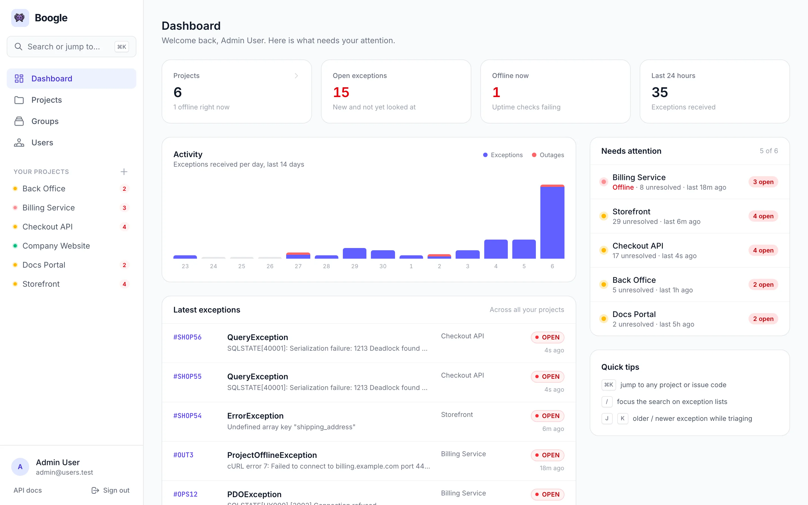
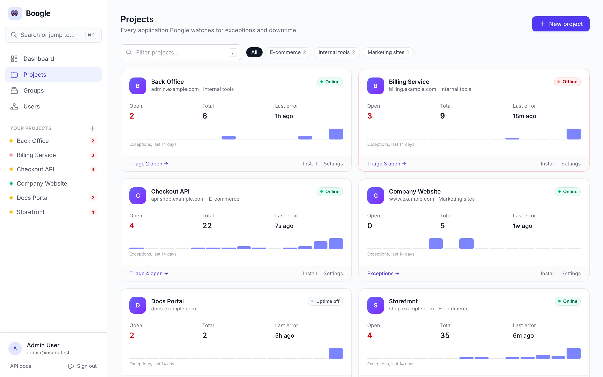
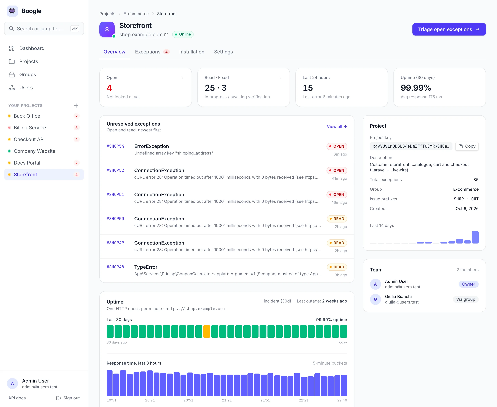
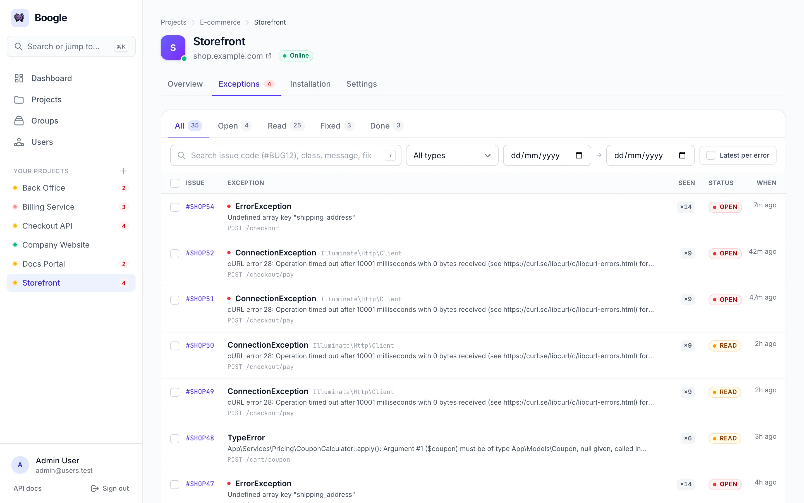
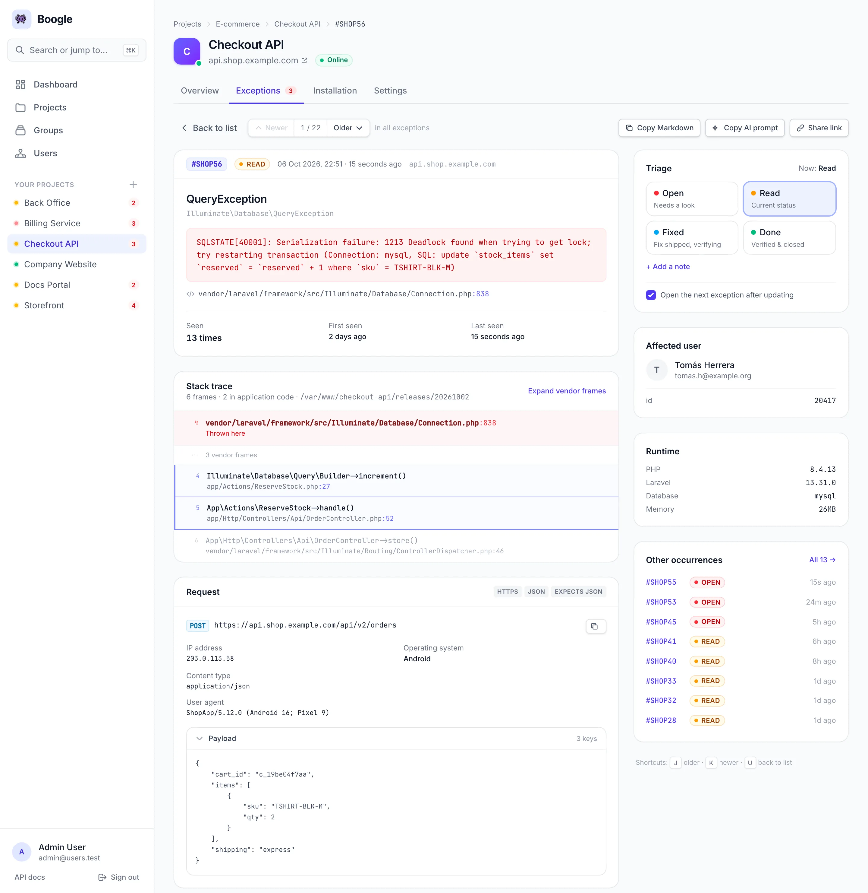
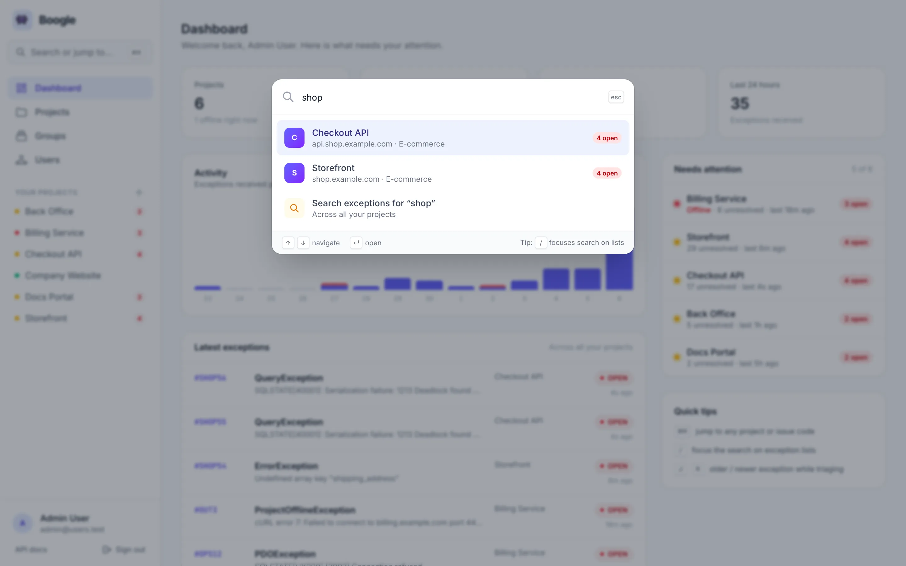
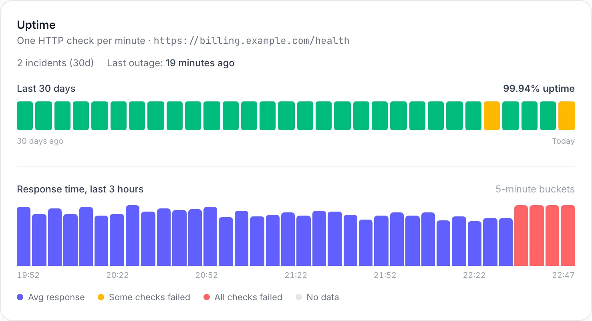

# Boogle

Boogle is a self-hosted Laravel platform to track application exceptions and monitor uptime.



> Screenshots in this README come from a real Boogle instance seeded with the bundled [demo data](#try-it-with-demo-data).

## Main Features

- **Exception ingestion** through `POST /api/log` (full client `exception` payload, including `http` and `user`), processed on the queue.
- **Issue codes** such as `#BUG42`, `#SHOP7` (group prefix) or `#OUT3` (outages), searchable from anywhere.
- **Fast triage**: one-click Open / Read / Fixed / Done with an optional note, then straight to the next exception of the list you came from.
- **Readable context**: stack traces with application frames highlighted and vendor frames collapsed, request, client, affected user, runtime, and how many times the same error was seen.
- **Navigation**: `⌘K` command palette, per-project tabs (Overview · Exceptions · Installation · Settings), a sidebar with live project health and cross-project search.
- **Uptime monitoring** per project, with an optional dedicated ping URL (`uptime_url`), a `ProjectOfflineException` when the project is unreachable, automatic transition to `DONE` on recovery, and email notifications for both.
- Projects, groups, users, 2FA, API tokens, bulk actions, a “latest per error” view and optional read-only public share links.
- **Self-updating**: stable releases or the main branch, every night or on demand from **Updates**, with a database backup and rollback.
- Sanctum-protected **Admin API** for project/group CRUD and exception management, documented with OpenAPI at `/api/docs`.

## Tour

| Projects | Project overview |
|---|---|
| [](docs/screenshots/projects.webp) | [](docs/screenshots/project-overview.webp) |
| Health, open exceptions and a 14-day sparkline per project. Filter with `/`, narrow by group. | Unresolved exceptions, uptime, project key and team behind the same tabs on every project page. |

| Exceptions | Triage |
|---|---|
| [](docs/screenshots/exceptions.webp) | [](docs/screenshots/exception.webp) |
| Status tabs with counts, search by issue code / class / message / file / URL, filters that apply as you change them, *Seen ×N* for repeated errors and bulk actions. | Collapsed vendor frames, structured request and user, triage buttons with notes and “open next”, copy as Markdown or as an AI prompt. |

| ⌘K palette | Uptime |
|---|---|
| [](docs/screenshots/command-palette.webp) | [](docs/screenshots/uptime.webp) |
| Jump to any project or page; type an issue code to open it directly. | One check per minute: 30 days of daily bars and a 3-hour response-time chart. |

### Keyboard shortcuts

| Shortcut | Where | Action |
|---|---|---|
| `⌘K` / `Ctrl+K` | Everywhere | Open the command palette |
| `/` | Lists | Focus the search box |
| `J` / `K` | Exception detail | Older / newer exception in the current list |
| `U` | Exception detail | Back to the list, filters preserved |

## Requirements

- PHP `^8.3`
- Composer
- Node.js + npm
- SQL database supported by Laravel (MySQL/MariaDB, PostgreSQL or SQLite)

## Quick Installation

1. Clone the repository and enter the project folder.
2. Run the full setup:

```bash
composer run setup
```

This command automatically runs:

- `composer install`
- `.env` creation from `.env.example` (if missing)
- `php artisan key:generate`
- `php artisan migrate --force`
- `npm install --ignore-scripts`
- `npm run build`

## Try It With Demo Data

To explore a lived-in instance before wiring your apps, seed the bundled demo (this **wipes the database**):

```bash
php artisan migrate:fresh --seed --seeder=DemoSeeder
```

It creates six projects in three groups (`#SHOP`, `#OPS` and `#BUG` prefixes), five users, about eighty exceptions in the `boogle-client` payload format with status history and notes, past and ongoing outages, and 30 days of per-minute uptime checks. Sign in as `admin@users.test` / `password`.

Every project, person and domain in the demo is fictional (`example.com`). Don't keep the scheduler running against demo data: the uptime checks would flag every project as offline.

For a quick local setup without MySQL, set `DB_CONNECTION=sqlite` in `.env`, comment out the other `DB_*` lines and create the file with `touch database/database.sqlite`.

## What Boogle Receives and Stores

With an up-to-date `andreapollastri/boogle-client`, the body of `POST /api/log` is `key` + `token` + `exception` (the full object). Boogle:

- **Ingestion** — stores the whole `exception` array in `raw_exception` (hidden from list responses, included in `GET /api/admin/projects/{project}/exceptions/{id}`) and maps it to columns: `http` (JSON), `user` (the app-side user), plus `host` / `method` / `fullUrl` for backwards compatibility.
- **Issue codes** — assigns a code such as `#BUG42` or `#OUT3` based on the group (optional prefix) or the type (outages are always `OUT`). Projects in the same group share the counter.
- **Panel** — the detail page shows the stack trace, the *Request* block and the *Affected user* from the client.
- **Privacy (optional)** — in `config/boogle.php` / `.env` you can hide `headers` and `session` from the detail page, the exports and public share pages. Public share pages never show the affected user.

After `php artisan vendor:publish --tag=boogle-config` in the monitored apps, keep the client's `http` section aligned.

## Client App Integration (monitored Laravel apps)

To send exceptions from another Laravel application into this Boogle instance, install the client package and wire the exception reporter.

1. Install and configure the client (the project **Installation** tab shows the exact values):

```bash
composer require andreapollastri/boogle-client
php artisan boogle:install
```

2. Set environment variables for the project you are monitoring:

```env
BOOGLE_KEY=<project_api_token>
BOOGLE_PROJECT_KEY=<project_key>
BOOGLE_SERVER=https://your-boogle-host.example/api/log
```

3. Register the reporter — the approach depends on your Laravel version:

### Laravel 11+ (`bootstrap/app.php`)

`->withExceptions()` and `Illuminate\Foundation\Configuration\Exceptions` are available from Laravel 11 onwards.

```php
<?php

use Boogle\Facade as Boogle;
use Illuminate\Foundation\Application;
use Illuminate\Foundation\Configuration\Exceptions;
use Illuminate\Foundation\Configuration\Middleware;

return Application::configure(basePath: dirname(__DIR__))
    ->withRouting(
        // web, api, commands, health, …
    )
    ->withMiddleware(function (Middleware $middleware): void {
        // middleware aliases, …
    })
    ->withExceptions(function (Exceptions $exceptions): void {
        $exceptions->reportable(function (\Throwable $e) {
            Boogle::handle($e);
        });
    })->create();
```

Or using the shorthand helper:

```php
->withExceptions(function (Exceptions $exceptions) {
    Boogle::registerExceptionHandler($exceptions);
})
```

### Laravel 9 / 10 (`app/Exceptions/Handler.php`)

Use the classic `Handler` class. In the `register()` method:

```php
use Boogle\Facade as Boogle;
use Throwable;

public function register(): void
{
    $this->reportable(function (Throwable $e) {
        Boogle::handle($e);
    });
}
```

> **Note:** `registerExceptionHandler` is not needed here — pass the `Throwable` directly to `Boogle::handle($e)`.

### Summary

| Laravel version | Where to configure |
|---|---|
| 11+ | `bootstrap/app.php` → `->withExceptions(fn($e) => Boogle::registerExceptionHandler($e))` |
| 9 / 10 | `app/Exceptions/Handler.php` → `register()` → `$this->reportable(fn($e) => Boogle::handle($e))` |

4. Verify connectivity:

```bash
php artisan boogle:test
```

The client only reports from the environments listed in its `environments` config (`production` by default).

## Environment Configuration

Update `.env` with:

- database connection (`DB_*`)
- mailer settings (`MAIL_*`) for notifications
- queue driver (`QUEUE_CONNECTION`)

If you need a clean reset after migration changes:

```bash
php artisan migrate:fresh --seed
```

## Running Locally

### Recommended mode (single command)

```bash
composer run dev
```

This starts:

- web server (`php artisan serve`)
- queue listener
- log tail (`php artisan pail`)
- Vite dev server

### Manual mode (separate terminals)

```bash
php artisan serve
php artisan queue:listen --tries=1 --timeout=0
php artisan schedule:work
npm run dev
```

## Testing

```bash
composer test
```

The suite runs on an in-memory SQLite database and covers ingestion, access control, triage and navigation, filters, global search and uptime checks.

## First Login

The default seeder creates an admin user:

- Email: `admin@users.test`
- Password: `password`

Change the password from **Profile** right after the first login.

After login:

- Panel: `/dashboard`
- Global search: `/search` (or `⌘K` anywhere)
- API docs UI: `/api/docs`

## Uptime Monitoring

Each project can configure:

- `uptime_enabled` (enable/disable ping)
- `uptime_url` (optional, fallback to project `url`)

Scheduled commands:

- `exceptions:send-digests` every minute
- `projects:check-uptime` every minute
- `exceptions:prune-old` daily at `04:00` (deletes exceptions older than 24 months)

Notes:

- outage issues are retained for 30 days, uptime checks for 45 days
- the uptime chart in the project overview shows the last 30 days

Manual testing:

```bash
php artisan projects:check-uptime
php artisan exceptions:send-digests
php artisan exceptions:prune-old
```

## Data Pruning Policy

- Exception retention: 24 months
- Prune command: `php artisan exceptions:prune-old`
- Schedule: daily at `04:00` via Laravel scheduler

## Admin API

Base path: `/api/admin`  
Auth: `Bearer <sanctum-token>` + admin user (create tokens from **Profile**)

Main endpoints:

- Projects: list/create/show/update/delete
- Groups: list/create/show/update/delete
- Exceptions: global list, list by project, show, update status

OpenAPI spec:

- static file: `public/openapi.json`
- rendered docs: `/api/docs`

## Quick Troubleshooting

- No email notifications:
    - verify `MAIL_*` in `.env`
    - verify the queue worker is running
- Exceptions not appearing:
    - verify the queue worker is running (ingestion is queued)
    - check that the client runs in an allowed environment
- Uptime not updating:
    - verify scheduler (`php artisan schedule:work` or cron)
    - run `php artisan projects:check-uptime` manually
- Invalid API token:
    - regenerate the project token from **Settings** and update `BOOGLE_KEY`

## Tech Stack

- Laravel 13, Sanctum
- Blade + Alpine.js
- Tailwind CSS 4 + Vite 8

## Updates

Boogle keeps itself up to date. Administrators find **Updates** in the sidebar: the installed release, the newest one, **Check now**, **Update to …** and **Force update**, the channel and the nightly update.

- **Channels**: *Stable* installs the release tags (`1.2.3`) and nothing in between; *Beta* follows the head of `main`, for a server you test on.
- **Never backwards**: a build is installed only when it contains the installed one. Back on stable after beta, Boogle keeps its main build until a release contains it. **Force update** installs the channel's newest build again (or one whose history differs), never an older one.
- **Every night** at `APP_UPDATE_TIME` (04:00 by default) while automatic updates are on; an update asked for on the page starts within a minute. Both run from the scheduler, so the cron entry below is required.
- **Safe**: each update backs up the database (`storage/app/updates/backups`, the newest 5 are kept), installs the build, runs `composer install --no-dev`, builds the assets when the release does not carry them, migrates, rebuilds the caches, restarts the queue workers and checks that Boogle boots. If a step fails, the previous code and the database come back. The log of the last run is on the page and in `storage/app/updates/update.log`.

Two kinds of installation update themselves:

| Installation | How it is updated |
| --- | --- |
| A git checkout (`git clone`, as in [Quick Installation](#quick-installation)) | in place: maintenance mode, checkout of the new build (detached), build, migrations. Tracked files changed by hand stop the update; **Force update** discards them. |
| A release of a deploy: `releases/<x>`, `current`, `shared/` ([Cipi](https://cipi.sh), Deployer) | the new build is cloned into `releases/<build>` next to the running one, shares its `.env` and `storage`, is built and migrated, then `current` points at it; Cipi's workers restart. A later `cipi deploy` keeps working as before. |

The scheduler's user runs the update, so it needs `git`, `composer` and the database client (`mysqldump`/`mysql`, `pg_dump`/`psql`) on its `PATH`, and write access to the application. From the command line:

```bash
php artisan app:update status          # what the last check and the last run said (JSON)
php artisan app:update check           # what the channel would install
php artisan app:update apply [--force] # update now
php artisan app:update channel stable  # or beta
php artisan app:update auto off        # or on
```

| Variable | Default | |
| --- | --- | --- |
| `APP_UPDATES` | on in production | `false` turns updates off |
| `APP_UPDATE_REPOSITORY` | `https://github.com/andreapollastri/boogle.git` | where builds come from |
| `APP_UPDATE_CHANNEL` | `stable` | the channel until an administrator picks one |
| `APP_UPDATE_AUTO` | `true` | the nightly update until an administrator switches it |
| `APP_UPDATE_TIME` | `04:00` | when the nightly update runs |
| `APP_UPDATE_BACKUP` | `true` | the database backup before each update |
| `APP_UPDATE_ASSETS` | `true` | build the assets (`npm`) when a release does not carry them |
| `APP_UPDATE_PHP`, `APP_UPDATE_COMPOSER`, `APP_UPDATE_NPM` | found on the `PATH` | the tools, when the scheduler's `PATH` does not have them |

The installed release is in the `VERSION` file.

## Production Deploy

Below is a minimal production setup for scheduler and queue workers.

### 1) Cron for Laravel scheduler

Add this cron entry on your server (usually with `crontab -e`):

```cron
* * * * * cd /var/www/boogle && php artisan schedule:run >> /dev/null 2>&1
```

This ensures scheduled commands (including uptime checks and digest jobs) run on time.

### 2) Queue worker with Supervisor

Create `/etc/supervisor/conf.d/boogle-worker.conf`:

```ini
[program:boogle-worker]
process_name=%(program_name)s_%(process_num)02d
command=php /var/www/boogle/artisan queue:work --sleep=3 --tries=3 --timeout=120
autostart=true
autorestart=true
stopasgroup=true
killasgroup=true
user=www-data
numprocs=2
redirect_stderr=true
stdout_logfile=/var/www/boogle/storage/logs/worker.log
stopwaitsecs=3600
```

Then apply:

```bash
sudo supervisorctl reread
sudo supervisorctl update
sudo supervisorctl start boogle-worker:*
```

### 3) Queue worker with systemd (alternative)

Create `/etc/systemd/system/boogle-queue.service`:

```ini
[Unit]
Description=Boogle Laravel Queue Worker
After=network.target

[Service]
User=www-data
Group=www-data
Restart=always
ExecStart=/usr/bin/php /var/www/boogle/artisan queue:work --sleep=3 --tries=3 --timeout=120
WorkingDirectory=/var/www/boogle
StandardOutput=append:/var/www/boogle/storage/logs/worker.log
StandardError=append:/var/www/boogle/storage/logs/worker-error.log

[Install]
WantedBy=multi-user.target
```

Then apply:

```bash
sudo systemctl daemon-reload
sudo systemctl enable boogle-queue
sudo systemctl start boogle-queue
sudo systemctl status boogle-queue
```

### 4) Post-deploy checklist

- Run migrations: `php artisan migrate --force`
- Clear/rebuild caches:
    - `php artisan config:cache`
    - `php artisan route:cache`
    - `php artisan view:cache`
- Ensure writable permissions for `storage` and `bootstrap/cache`
- Verify:
    - scheduler executes every minute
    - queue workers are online
    - mails are delivered correctly
